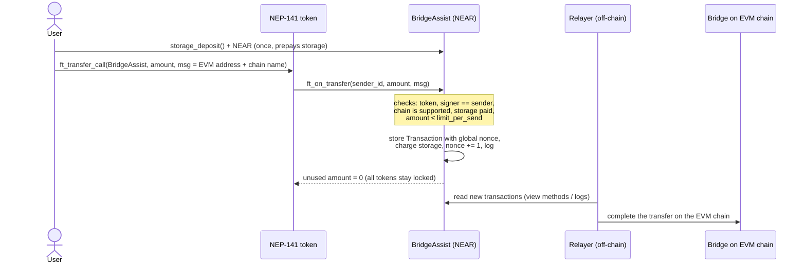
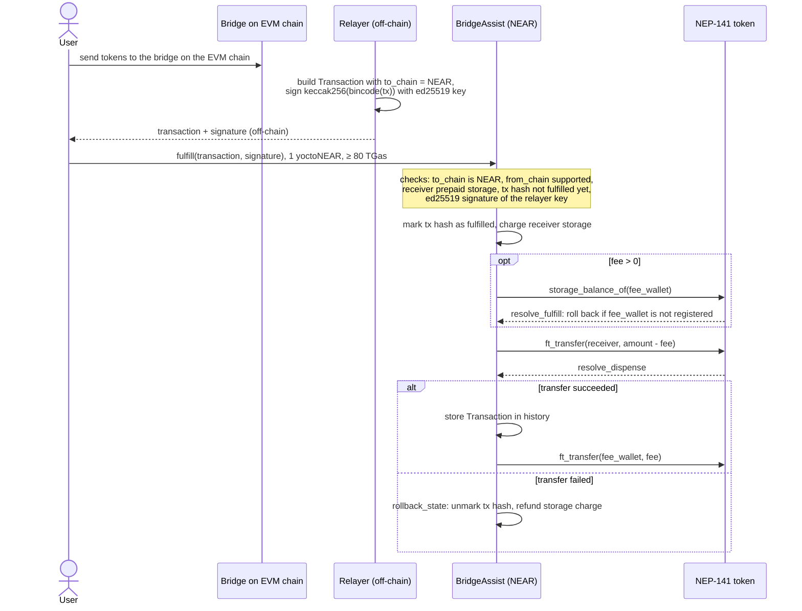

# near-evm-bridge

NEAR side of a NEAR ↔ EVM token bridge: the `BridgeAssist` smart contract in Rust (near-sdk 4.1) with integration tests on near-workspaces.

[](https://github.com/catcatcat8/near-evm-bridge/actions/workflows/ci.yml) [](LICENSE)

> Written by hand in March 2023. The contract, tests and scripts are kept exactly as they were written; only the README, LICENSE, .gitattributes and the CI workflow were added later (2026). CI builds the original code with Rust 1.67.1 and runs all 18 integration tests on the fresh build.

## Overview

A bridge moves a fungible token between NEAR and EVM chains. On NEAR, `BridgeAssist` holds a pool of one NEP-141 token:

- **NEAR → EVM:** the user sends tokens to the contract with `ft_transfer_call`. The contract locks them and stores a transfer record. An off-chain relayer reads the record and completes the transfer on the EVM chain.
- **EVM → NEAR:** the relayer signs the transfer with its ed25519 key. Anyone can submit the signed transfer to `fulfill`. The contract checks the signature and sends tokens from its pool to the receiver, minus a fee.

The contract went to NEAR mainnet in April 2023, bridging a production token to Ethereum and BSC (see [Deployments](#deployments)). The EVM contract and the relayer are not part of this repository.

## How it works

### NEAR → EVM



`msg` is the 42-character EVM address (`0x` + 40 hex characters) followed by a chain name that the owner added with `add_chain`, for example `0x...BSC`.

### EVM → NEAR



The tx hash is marked as fulfilled **before** the cross-contract calls, so the same transfer cannot be submitted twice while the first call is still in flight. If the token transfer fails, the hash is removed again and the transfer can be retried.

### Transfer record

```rust
pub struct Transaction {
    from_user: String,   // NEAR account or EVM address
    to_user: String,     // EVM address or NEAR account
    amount: U128,
    timestamp: U64,      // seconds
    from_chain: String,  // "NEAR" for outgoing transfers
    to_chain: String,    // "NEAR" for incoming transfers
    nonce: U128,
}
```

The relayer signs `keccak256(bincode::serialize(&tx))`. The contract exposes the same hash with the `get_tx_hash` view method, so the relayer and the tests can compute it without reimplementing the serialization.

### Fees, limits and storage

- **Fee:** `fee_numerator / 10000` of the amount, taken on EVM → NEAR transfers and sent to `fee_wallet`.
- **Limit:** `limit_per_send` caps a single NEAR → EVM transfer.
- **Storage:** users prepay NEAR for the storage their transfers use (`storage_deposit`). At `init` the contract measures how many bytes a registration, an `ft_on_transfer`, a `fulfill` and an `add_chain` take, and charges exactly that. `get_storage_paid_info` returns the prices and the user's balance. Unused deposit can be withdrawn with `storage_withdraw`.

## Contract methods

| Method | Called by | What it does |
|---|---|---|
| `init(owner, relayer_role, token, fee_wallet, limit_per_send, fee_numerator)` | deployer | Sets config, checks that the relayer key is ed25519, measures storage costs |
| `ft_on_transfer(sender_id, amount, msg)` | the bridged token (from user's `ft_transfer_call`) | Locks tokens and records a NEAR → EVM transfer |
| `fulfill(transaction, signature)` | anyone with a relayer signature | Verifies the signature and releases tokens for an EVM → NEAR transfer |
| `resolve_fulfill`, `dispense_ft_to_user`, `resolve_dispense`, `rollback_state` | the contract itself (`#[private]`) | Callback chain of `fulfill` |
| `storage_deposit()` | user | Registers the user and adds NEAR to their storage balance |
| `storage_withdraw(amount)` | user | Returns unused storage deposit |
| `add_chain(chain)` / `remove_chain(chain)` | owner | Manages the list of supported chains (owner pays / gets back storage) |
| `set_fee_numerator`, `set_fee_wallet`, `set_limit_per_send`, `set_relayer_role` | owner | Updates config |
| `transfer_ownership(owner)` | owner | Sets a new owner |
| `withdraw(amount)` | owner | Withdraws bridged tokens from the pool (liquidity management) |
| `withdraw_native_fee(amount)` | owner | Withdraws NEAR, but never below the sum of users' storage deposits |
| `get_owner`, `get_relayer_role`, `get_token`, `get_fee_info`, `get_limit_per_send`, `get_nonce` | anyone (view) | Config |
| `get_transaction_by_user`, `get_transactions_by_user`, `get_transactions_amount_by_user` | anyone (view) | Transfer history by sender |
| `is_tx_fulfilled(tx_hash)`, `get_tx_hash(transaction)` | anyone (view) | Replay status and hash for signing |
| `supported_chain_list`, `is_available_chain`, `get_storage_paid_info`, `get_pay_for_add_chain` | anyone (view) | Chains and storage prices |

## Security model

- **Relayer:** EVM → NEAR transfers are authorized by one ed25519 relayer key. The contract trusts the relayer to sign only transfers that were really made on the EVM side. The owner can rotate the key with `set_relayer_role`.
- **Replay protection:** each incoming transfer is identified by the hash of its full `Transaction`. The hash is stored in `fulfilled` and a second `fulfill` with the same data is rejected.
- **Owner:** the owner manages supported chains, fee, limit and relayer key, and manages pool liquidity with `withdraw`. The owner is trusted.
- **User funds in NEAR:** `withdraw_native_fee` cannot take NEAR that users deposited for storage.
- **Arithmetic:** the release profile has `overflow-checks = true`.

## Deployments

### Mainnet (April 2023)

| Network | Contract | Address |
|---|---|---|
| NEAR | BridgeAssist (this contract) | [`paras-bridge-contract.near`](https://nearblocks.io/address/paras-bridge-contract.near) |
| NEAR | Bridged token (NEP-141) | [`token.paras.near`](https://nearblocks.io/address/token.paras.near) |
| Ethereum | Bridge, EVM side | [`0xa1dC364E4ec65337734afA3c851b60b83719176d`](https://etherscan.io/address/0xa1dC364E4ec65337734afA3c851b60b83719176d) |
| BSC | Bridge, EVM side | [`0xa1dC364E4ec65337734afA3c851b60b83719176d`](https://bscscan.com/address/0xa1dC364E4ec65337734afA3c851b60b83719176d) |

Supported chains on the NEAR contract: `ETH`, `BSC`. Ownership was transferred to the client after launch.

The mainnet build has the same logic as `src/lib.rs`. The only differences are the `Transaction` field names, which are in camelCase there (`fromUser`, `toUser`, `fromChain`, `toChain`), and two error messages.

### Testnet

| Contract | Account |
|---|---|
| BridgeAssist | [`nearbridgev4.gotbit.testnet`](https://testnet.nearblocks.io/address/nearbridgev4.gotbit.testnet) |
| Test token (NEP-141) | [`parastoken.gotbit.testnet`](https://testnet.nearblocks.io/address/parastoken.gotbit.testnet) |

The code hashes on testnet match the files in `res/`: `near_bridge_assist.wasm` → `3bKnAgnRMgUp5TBsvKvyWkeRD7DSaUjn7Qdf2WuPfVkC`, `fungible_token.wasm` → `3w3jFRwHXBqLsZawY9HKNHWfA2es6RT3eTz42c6jZDKd`. Deploy logs are in `deployments/testnet/`.

## Getting started

### Requirements

- Rust **1.67.1** with the `wasm32-unknown-unknown` target (the version checked with near-sdk 4.1; newer Rust versions are not checked)
- Node.js 18+ and Yarn 1
- near-cli 3.x for deployment

### Build

```bash
rustup toolchain install 1.67.1
rustup target add wasm32-unknown-unknown --toolchain 1.67.1
cargo +1.67.1 build --target wasm32-unknown-unknown --release
# output: target/wasm32-unknown-unknown/release/near_bridge_assist.wasm
```

`res/` contains prebuilt `near_bridge_assist.wasm` and `fungible_token.wasm` (the NEP-141 example token). The integration tests use these files.

### Test

The tests start a local NEAR sandbox node. The sandbox binary that near-workspaces 3.x downloads by default is no longer hosted, so point it to a released version:

```bash
cd integration-tests
# Linux x86_64; on macOS use Darwin-x86_64 or Darwin-arm64
export SANDBOX_ARTIFACT_URL=https://s3-us-west-1.amazonaws.com/build.nearprotocol.com/nearcore/Linux-x86_64/1.35.0/near-sandbox.tar.gz
yarn install --frozen-lockfile
npx ava --serial
```

Every test starts a fresh sandbox and deploys the bridge and two tokens, so a serial run takes about 10–15 minutes. `npx ava --concurrency 4` is faster; CI uses it and finishes the tests in about a minute.

The 18 tests cover: init, storage deposit/withdraw, `ft_on_transfer` (success and rejections), `fulfill` (success with and without fee, rejections, rollback when the token transfer fails, rollback when the fee wallet is not registered), and all owner functions.

### Deploy

near-cli 3.x commands, as used for the testnet deployment (see `Makefile`):

```bash
near deploy --accountId <bridge-account> \
  --wasmFile res/near_bridge_assist.wasm \
  --initFunction init \
  --initArgs '{"owner": "<owner>", "relayer_role": "ed25519:<relayer public key>", "token": "<token-account>", "fee_wallet": "<fee-wallet>", "limit_per_send": "<amount>", "fee_numerator": 1000}'

# register the bridge in the token contract
near call <token-account> storage_deposit '{"account_id": "<bridge-account>"}' --accountId <bridge-account> --amount 0.00125

# add a destination chain (attach at least get_pay_for_add_chain)
near call <bridge-account> add_chain '{"chain": "BSC"}' --accountId <owner> --amount 0.1
```

## Project structure

```
.
├── src/lib.rs              # BridgeAssist contract
├── integration-tests/
│   └── src/main.ava.ts     # near-workspaces + ava tests
├── res/                    # prebuilt wasm: bridge and NEP-141 token
├── scripts/                # build and dev-deploy scripts
├── deployments/testnet/    # testnet deploy logs
├── Makefile                # build and testnet commands
└── Cargo.toml
```

## My role

I wrote this contract and its integration tests in March 2023 at Gotbit, as the NEAR side of a NEAR ↔ EVM bridge, and deployed it to NEAR mainnet in April 2023. The same contract later became the base of Gotbit's white-label NEAR ↔ EVM bridge. The EVM contract and the relayer backend are not included in this repository.

## License

[MIT](LICENSE)
